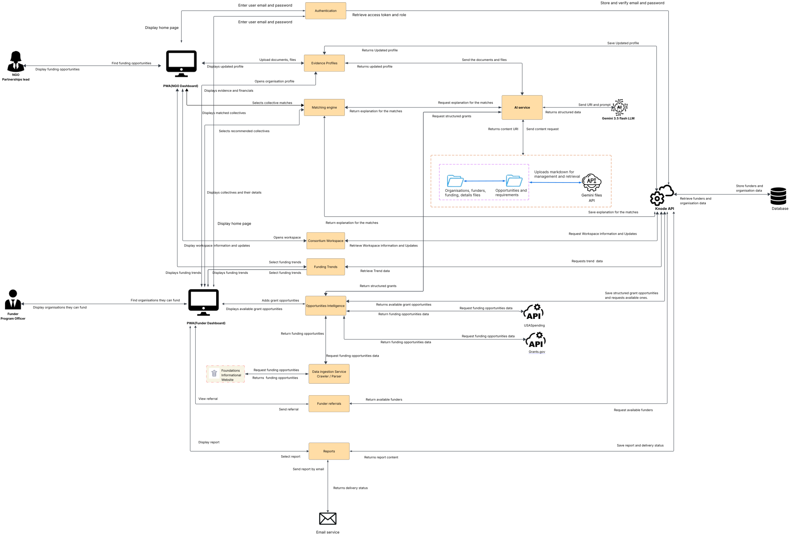
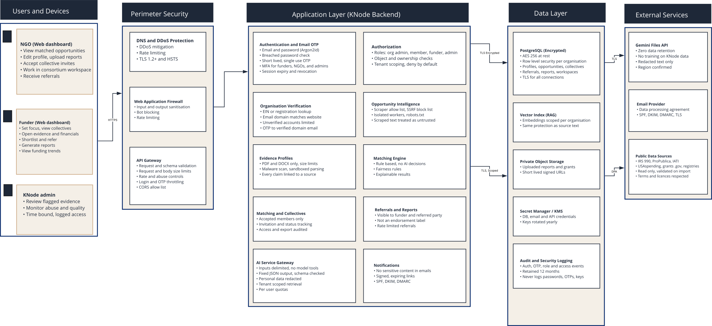

# KNode Technical Architecture & AI Integration

---

## 1. Architecture Overview

KNode is a single application with separate background processing. Users work in dashboards for NGOs, funders and administrators, which send requests to a central interface that checks identity and permissions. The interface is divided into self-contained modules, such as authentication, verification, matching and reports. Slow tasks, such as collecting data, reading documents and running AI extraction, are queued and handled by background workers, so users never wait for them. Data is stored in a PostgreSQL database and in private encrypted storage. This keeps the system simple to run, responsive, and easy to expand later.

### 1.1 System Architecture Diagram

*Figure 1. End-to-end data flow for NGO and Funder users across the frontend, backend modules, database and external services.*

---

## 2. System Components

| Component | Responsibility |
| :--- | :--- |
| **NGO and Funder dashboards** | NGOs manage profiles and upload evidence; funders create grants, discover organizations and view collectives and funding trends |
| **Admin portal** | System monitoring, review of flagged evidence and access management |
| **Authentication** | Login, one-time passwords, tokens and role-based access |
| **Organization verification** | Confirms that applicants are legitimate US-registered organizations |
| **Evidence Profiles** | Turns uploaded evidence into normalized capability profiles |
| **Opportunity Intelligence** | Collects funding opportunities and stores them as structured records |
| **Matching Engine** | Scores compatibility between organizations and funding opportunities using fixed rules |
| **Collectives** | Supports coalition formation and shared workspaces |
| **Funding Trends** | Shows funding patterns to funders |
| **Referrals** | Manages the lifecycle of funder-to-NGO interactions |
| **Reports** | Generates and emails platform reports |
| **Data Ingestion Service** | Background workers that collect and parse data from external sources |
| **AI Service Gateway** | The only route to the AI provider; sends redacted text and returns structured results |
| **Notifications** | Sends one-time passwords, alerts and report emails |

---

## 3. Data Architecture

### 3.1 Data stores

| Store | Contents |
| :--- | :--- |
| **PostgreSQL** | Users, organizations, profiles, opportunities, collectives, referrals, reports, extraction results |
| **pgvector (same PostgreSQL instance)** | Document chunks and embeddings used for semantic search |
| **Audit and security log store** | Authentication, access and privileged-action events |
| **Encrypted backups** | Daily database backups in a separate region |

### 3.2 External sources and services

| Source or service | Use |
| :--- | :--- |
| **IRS exempt organization data and Form 990 filings** | Verifying and discovering US-registered organizations; financial and geographic information |
| **Grants.gov and USAspending** | Funding opportunities and historical award data |
| **NGO websites and funder documents** | Evidence of programs and funding requirements, collected by the ingestion service |
| **AI provider (Gemini)** | Extracts structured data from text, through the AI Service Gateway |
| **Email provider** | Delivers one-time passwords, alerts and reports |

### 3.3 Retention

- Audit logs are kept for 12 months.
- Uploaded evidence is kept while the organization is active and deleted on request or account closure, together with derived chunks and embeddings.
- Deletions are logged.

---

## 4. Deployment and Operations

- Separate development, staging and production environments, each with its own database, storage, keys and credentials.
- Containerized web, API and worker services; the worker pool scales independently.
- Managed PostgreSQL, object storage and secrets management.
- Automated testing and gated promotion to production through CI/CD, with infrastructure defined as code.

---

## 5. Security Architecture

The security architecture is organized by layer, as shown in the Security System Architecture Diagram: users and devices, perimeter security, the application layer, the data layer and external services.

### 5.1 Security System Architecture Diagram

*Figure 2. Security controls by layer: users and devices, perimeter security, application layer, data layer and external services.*

---

## 6. Security Layers

| Layer | Components | Security implementation |
| :--- | :--- | :--- |
| **Users and devices** | NGO dashboard, Funder dashboard, Admin portal (Next.js) | All traffic over HTTPS; admin access is time-bound and logged; flagged evidence is reviewed by admins |
| **Perimeter security** | Cloudflare DNS and DDoS protection, Web Application Firewall, API gateway | DDoS mitigation, TLS 1.2+ and HSTS, input and output sanitization, bot blocking, rate limiting, request and schema validation, CORS allow-list |
| **Application layer** | FastAPI backend: authentication, authorization, organization verification, evidence profiles, opportunity intelligence, matching engine, matching and collectives, referrals and reports, AI Service Gateway, notifications | Login and OTP protection, role and ownership checks, tenant scoping, upload scanning, source-linked claims, redaction before AI calls, signed email links |
| **Data layer** | PostgreSQL, vector index, private object storage, secrets manager and KMS, audit logging, encrypted backups | Encryption at rest and in transit, Row-Level Security, pre-signed URLs, key rotation, 12-month audit logs, daily backups with quarterly restore tests  |
| **External services** | AI provider (Gemini), email provider, public data sources | Redacted text only to the AI provider under the provider agreement; SPF, DKIM and DMARC on email; public sources read-only, validated on import, with terms respected |

---

## 7. Identity and Access Management

### 7.1 Authentication

- Email and password with hashed passwords and a breached-password check.
- Short-lived, single-use email OTP with attempt limits.
- Funders and admins also use TOTP or passkeys.
- Short-lived access tokens with rotating refresh tokens, stored in `httpOnly`, `Secure`, `SameSite` cookies. A reused refresh token revokes the whole token family, and a server-side store allows logout and account suspension.
- Per-account and per-IP throttling with progressive lockout.

### 7.2 Authorization

- Role-based access control for NGO member, NGO admin, Funder member, Funder admin and KNode admin.
- Every request checks ownership of the object, not just the role.
- Requests without a resolved tenant are rejected.

### 7.3 Organization verification

1. The EIN is checked against IRS exempt organization data and must be listed and not revoked.
2. The applicant's email domain must match the organization's website.
3. An OTP sent to a verified-domain email confirms control of the domain.
4. Unverified or mismatched applications are held for admin review.

Verification status is re-checked on a schedule to detect later IRS revocations.

---

## 8. Data Protection and Tenant Isolation

- **Encryption:** data is encrypted at rest and in transit, and sensitive fields are encrypted again at application level.
- **Row-Level Security (RLS):** PostgreSQL enforces tenant isolation, so one organization can never read another's private data. Vector data follows the same policies.
- **Tenant context:** the API sets the tenant for every request inside the database transaction. Application database roles cannot bypass RLS, and automated tests attempt cross-tenant access on every tenant-private table.
- **Shared data:** published profile fields, verified capabilities and published opportunities are readable by authenticated users according to a visibility flag, so funders can discover organizations.
- **Documents:** uploads are stored privately with SSE-KMS encryption and served only through short-lived pre-signed URLs.
- **Secrets and keys:** held in the secrets manager and KMS with least-privilege access and key rotation.
- **Backups:** encrypted, daily, kept for 30 days in a separate region, with quarterly restore tests.

---

## 9. Upload, Ingestion and AI Gateway Controls

- **Uploads:** file type allowlist, size and page limits, content-type check, malware scan and sandboxed parsing.
- **Ingestion:** allow-listed targets only, protection against server-side request forgery, isolated workers, and scraped content treated as untrusted.
- **AI Service Gateway:** personal data is redacted before any text leaves the platform, source text is passed as untrusted data, and results are validated against the source before being saved. Records from documents flagged as suspected injections are held for review rather than published automatically. Per-tenant quotas limit misuse.

---

## 10. Audit and Logging

- Authentication, OTP, access and privileged-action events are logged, with critical data changes.
- Logs are append-only and kept for 12 months.
- Logs never contain passwords, OTPs, keys or document content.

---

