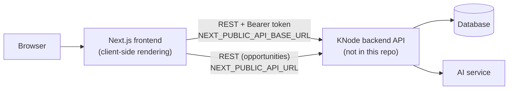
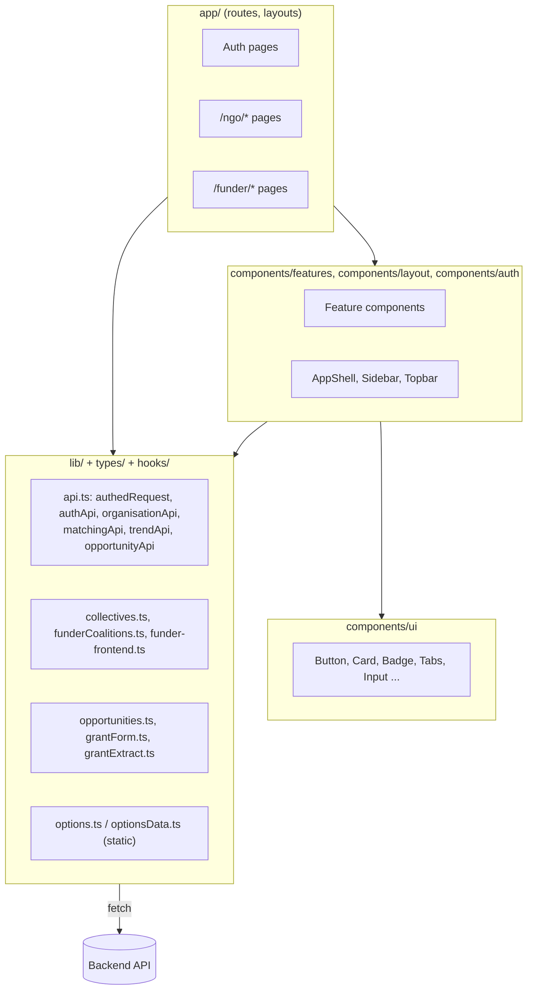
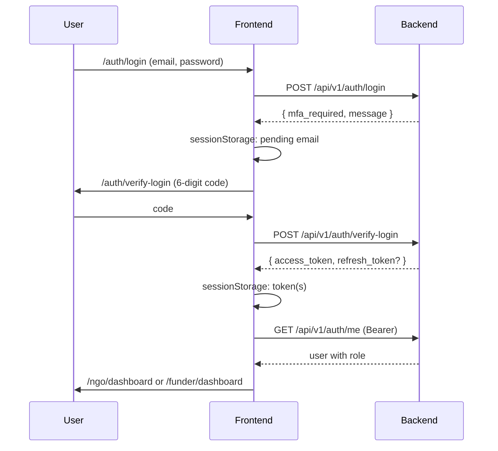

# Frontend Web

This page documents the KNode web frontend **as implemented** in the `alya-frontend-develop` repository. It describes the code that exists, not the product plan. Where the MVP document or the OpenAPI spec disagrees with the code, the discrepancy is stated.

Implementation status labels used throughout:

| Label                         | Meaning                                                             |
| ----------------------------- | ------------------------------------------------------------------- |
| **Integrated**                | UI calls a backend endpoint that exists in the bundled OpenAPI spec |
| **Integrated, path mismatch** | UI calls an endpoint whose path differs from the bundled spec       |
| **Static data**               | UI works from data embedded in the frontend                         |
| **Placeholder**               | Control or page exists but is disabled, hard-coded or absent        |
| **Absent**                    | No code found                                                       |

---

## 1. Frontend Overview

The frontend is a Next.js web dashboard with two role-specific areas that share one application shell:

- **NGO area** (`/ngo/*`): dashboard, opportunity search and detail, match assessments with partner suggestions, collectives and the consortium workspace, trend analysis, organisation profile and evidence documents.
- **Funder area** (`/funder/*`): dashboard, grant (opportunity) management with AI-assisted extraction from an uploaded file, organisation discovery with evidence view, coalition (collective) review.

It has no server-side logic of its own. Every page is a client component (or a thin server wrapper around one) that calls the KNode REST API directly from the browser. There is no Next.js route handler, server action, or middleware in the repository.

**Roles.** The backend returns `ORGANISATION` or `FUNDER` for the current user (`lib/api.ts` `Role`). After login the frontend routes `ORGANISATION` to `/ngo/dashboard` and `FUNDER` to `/funder/dashboard` (`components/auth/otp-form.tsx`).



The backend, database and AI boxes are taken from the existing architecture page. Nothing in the frontend repository lets us verify them.

---

## 2. Technology Stack

Versions are the ranges declared in `package.json`. The installed versions depend on `package-lock.json` and were not checked.

| Area            | Technology (declared version)                                               | Role in the application                                                       |
| --------------- | --------------------------------------------------------------------------- | ----------------------------------------------------------------------------- |
| Framework       | Next.js `16.4.1` (App Router)                                               | Routing, layouts, fonts, images                                               |
| UI library      | React `19.3.0`                                                              | Components and hooks                                                          |
| Language        | TypeScript `^5`, `strict: true`                                             | Typing; path alias `@/*` → repo root                                          |
| Styling         | Tailwind CSS `^4` via `@tailwindcss/turbopack`                              | Utility classes and `@theme` tokens in `app/globals.css`                      |
| Extra CSS       | Plain `.css` files per feature                                              | Used alongside Tailwind (see [Section 9](#9-ui-components-and-design-system)) |
| Icons           | `lucide-react` `^1.60.0`                                                    | All icons                                                                     |
| Forms           | `react-hook-form` `^7.90.0` + `@hookform/resolvers` `^6.0.0`                | Grant form only                                                               |
| Validation      | `zod` `^4.6.7`                                                              | Auth field validation, grant form schema                                      |
| Charts          | `recharts` `^3.10.1`                                                        | Trend line chart                                                              |
| Data fetching   | Native `fetch`                                                              | No SWR, React Query, or Axios                                                 |
| State           | React hooks and one unused context                                          | No Redux/Zustand                                                              |
| Auth            | Backend-issued bearer token in `sessionStorage`                             | See [Section 6](#6-authentication-and-access-control)                         |
| Tests           | `vitest` `^5.0.5`, jsdom, Testing Library                                   | Unit and component tests                                                      |
| Lint/format     | ESLint `^9` (`eslint-config-next`), Prettier `^3.9.10`, Husky + lint-staged | Pre-commit checks                                                             |
| Package manager | npm (`package-lock.json`)                                                   |                                                                               |
| Font            | `Outfit` via `next/font/google`                                             | Global typeface                                                               |

`next.config.ts` enables `experimental.agentFeedback`, `cacheComponents` and `partialPrefetching`, and routes `*.css` through `@tailwindcss/turbopack`. Because all data is fetched client-side, the practical effect of `cacheComponents` on data caching could not be established from the code.

The `package.json` name is `tmp-app` and the README title is `fe-sample-template`, both template leftovers.

---

## 3. Frontend Architecture

### 3.1 Shape of the application

The code is organised in four layers. The boundaries are conventional, not enforced by tooling.



### 3.2 Entry point and initialisation

- `app/layout.tsx` is the only root layout. It loads the `Outfit` font, sets metadata (`title: "KNode"`), and renders `<html lang="en">` with `children`. It does **not** mount any provider.
- `app/page.tsx` redirects `/` to `/auth/signup`.

### 3.3 Separation of concerns

- **Presentation:** `components/ui/*` (generic) and `components/features/*` (domain-specific cards, panels, lists).
- **Data access:** `lib/*.ts`. Pages call these functions directly; there is no hooks layer for most data. Custom hooks exist only for opportunities (`usePagedOpportunities`, `useAllGrants`) and media queries (`hooks/UseMediaQuery.ts`).
- **Business logic:** mixed. Grant form logic is well separated (`lib/grantForm.ts`, `lib/grantFormSchema.ts`, `lib/grantExtract.ts`). Other pages (for example `app/ngo/dashboard/page.tsx`, `app/funder/organisations/page.tsx`) combine fetching, derivation and rendering in one file, at 560–720 lines each.

---

## 4. Directory and File Structure

```text
alya-frontend-develop/
├── app/                         # App Router
│   ├── layout.tsx               # root layout (font, metadata)
│   ├── page.tsx                 # redirect → /auth/signup
│   ├── globals.css              # Tailwind import + @theme tokens
│   ├── auth/{signup,login,verify-login,verify-email}/page.tsx
│   ├── ngo/                     # layout.tsx + dashboard, opportunities[/id],
│   │                            #   collectives[/id], trends, organisation_profile
│   └── funder/                  # layout.tsx + dashboard, opportunities[/new|/id|/id/edit],
│                                #   organisations[/id], coalitions[/id]
├── components/
│   ├── auth/otp-form.tsx        # shared 6-digit OTP entry
│   ├── layout/                  # AppShell, Sidebar, Topbar, PageHeader
│   ├── ui/                      # Button, Card, Panel, Badge, Tag, Tabs, Input, Select,
│   │                            #   Textarea, Checkbox, Toggle, Avatar, ProgressBar,
│   │                            #   Pagination, SearchInput, FilterChips, StatCard, field.ts
│   └── features/                # MatchPanel, CoalitionPanel, GrantFormPage, GrantUpload,
│                                #   OpportunityCard/Filters, TaskList, DocumentList,
│                                #   DiscussionThread, RequirementsChecklist, TrendChart ...
├── lib/                         # API clients, domain helpers, hooks, static options
├── context/authContext.tsx      # unused AuthProvider
├── hooks/UseMediaQuery.ts
├── types/                       # funder, coalition, user, matching, organisation, opportunity
├── __tests__/                   # 10 Vitest files
├── docs/openapi.json            # snapshot of backend OpenAPI 3.1 spec
├── public/                      # logo and auth artwork (plus default Next.js SVGs)
├── .github/                     # PR template + PR-checklist workflow
├── .husky/pre-commit            # runs lint-staged
└── next.config.ts, tsconfig.json, vitest.config.ts, eslint.config.mjs
```

Representative files by responsibility:

| Concern             | File                                                        | Purpose                                                                                                               |
| ------------------- | ----------------------------------------------------------- | --------------------------------------------------------------------------------------------------------------------- |
| HTTP + auth storage | `lib/api.ts`                                                | `authedRequest`, `ApiError`, `authApi`, `authStorage`, `organisationApi`, `matchingApi`, `trendApi`, `opportunityApi` |
| Opportunities       | `lib/opportunities.ts`                                      | `OPPORTUNITIES_URL`, types, formatters, paging fetchers                                                               |
| Grant authoring     | `lib/grantForm.ts`, `grantFormSchema.ts`, `grantExtract.ts` | Form model, zod schema, publish/rollback, AI extraction                                                               |
| Collectives         | `lib/collectives.ts`, `lib/threads.ts`                      | NGO collective/workspace calls; thread encoding                                                                       |
| Funder data         | `lib/funder-frontend.ts`, `lib/funderCoalitions.ts`         | Funder dashboard, matches, coverage, coalition views                                                                  |
| Matching            | `lib/matching.ts`                                           | Normalisers that default missing arrays                                                                               |
| Navigation          | `lib/nav.ts`                                                | Role-keyed nav items                                                                                                  |
| Static options      | `lib/options.ts`, `lib/optionsData.ts`                      | Statuses, sectors, countries, limits (see [Section 8](#8-feature-implementation))                                     |

---

## 5. Routing and Navigation

Routing uses the Next.js App Router file convention. There is no `middleware`/`proxy` file, no `not-found.tsx`, no `error.tsx` and no `loading.tsx` anywhere in `app/`.

**Navigation.** `lib/nav.ts` defines `navByRole`; `Sidebar` renders the list for the user's role and marks the active item via `pathname.startsWith(href + "/")`. `Topbar` builds a one-level breadcrumb from the path.

**Guards.** Protection is client-side only:

- `/ngo/*`: `app/ngo/layout.tsx` redirects to `/auth/login` when `fetchCurrentUser()` returns null or throws. It does **not** check that the user's role is `ORGANISATION`.
- `/funder/*`: no guard. The funder layout renders for anyone. Individual funder API calls will return errors for unauthenticated users; the funder dashboard loader additionally throws if `role !== "FUNDER"` (`lib/funder-frontend.ts`).
- `/auth/*`: no redirect for already-signed-in users.

**Invalid routes.** Handled by Next.js defaults.

!!! warning "Frontend routing is not authorisation"
These checks decide what the interface shows. They do not protect data. The backend must authorise each request by token and role. Given that the funder area has no frontend guard at all, backend enforcement is the only barrier there.

### Route summary

| Route or Route Pattern              | Page or Feature                                                                             | Access Requirements                      | Implementation Status                                             |
| ----------------------------------- | ------------------------------------------------------------------------------------------- | ---------------------------------------- | ----------------------------------------------------------------- |
| `/`                                 | Redirect to `/auth/signup`                                                                  | None                                     | Implemented                                                       |
| `/auth/signup`                      | Registration (role choice, EIN for organisations)                                           | None                                     | Integrated                                                        |
| `/auth/verify-email`                | Email OTP after signup                                                                      | Pending email in `sessionStorage`        | Integrated                                                        |
| `/auth/login`                       | Email + password step                                                                       | None                                     | Integrated                                                        |
| `/auth/verify-login`                | Login OTP, stores token                                                                     | Pending email in `sessionStorage`        | Integrated                                                        |
| `/ngo/dashboard`                    | Matches, opportunities, partner suggestions                                                 | Client check: valid user (no role check) | Integrated                                                        |
| `/ngo/opportunities`                | Search/filter/paginate opportunities                                                        | Client check via layout                  | Integrated (raw fetch)                                            |
| `/ngo/opportunities/[id]`           | Opportunity detail, requirements, match assessment, partners                                | Client check via layout                  | Integrated                                                        |
| `/ngo/collectives`                  | Collective list, accept/decline invitations                                                 | Client check via layout                  | Integrated (unprefixed paths, match spec)                         |
| `/ngo/collectives/[id]`             | Collective detail, coverage, workspace                                                      | Client check via layout                  | Partially implemented                                             |
| `/ngo/trends`                       | Trend line chart with filters                                                               | Client check via layout                  | Integrated                                                        |
| `/ngo/organisation_profile`         | View/edit profile, evidence documents, upload                                               | Client check via layout                  | Integrated                                                        |
| `/funder/dashboard`                 | Funder opportunities with matches and coalition policy (loader in `lib/funder-frontend.ts`) | None in layout; loader requires `FUNDER` | Integrated                                                        |
| `/funder/opportunities`             | Funder's own grants                                                                         | None in layout                           | Integrated                                                        |
| `/funder/opportunities/new`         | Create grant (3 steps, AI extraction)                                                       | None in layout                           | Integrated                                                        |
| `/funder/opportunities/[id]`        | Grant detail, delete                                                                        | None in layout                           | Integrated                                                        |
| `/funder/opportunities/[id]/edit`   | Edit grant and requirements                                                                 | None in layout                           | Integrated                                                        |
| `/funder/organisations`             | Discover organisations (filters, 9 per page)                                                | None in layout                           | Integrated                                                        |
| `/funder/organisations/[id]`        | Organisation profile, evidence, match                                                       | None in layout                           | Integrated                                                        |
| `/funder/coalitions`                | Coalitions per opportunity                                                                  | None in layout                           | Integrated                                                        |
| `/funder/coalitions/[id]`           | Coalition coverage and members                                                              | None in layout                           | Partially implemented (Shortlist and Select buttons are disabled) |
| `/ngo/settings`, `/funder/settings` | Linked from the sidebar                                                                     | n/a                                      | **Absent**: no page exists                                        |

---

## 6. Authentication and Access Control

### 6.1 Flow

Authentication is a two-step, OTP-based flow implemented against `/api/v1/auth/*`.



- **Registration:** `app/auth/signup/page.tsx` chooses `ORGANISATION` or `FUNDER`, validates with `lib/validation.ts` (zod: email, password ≥ 8 chars with upper, lower and digit, required names; EIN required for organisations), calls `authApi.register`, stores the email and goes to `/auth/verify-email`, then back to `/auth/login`.
- **OTP entry:** `components/auth/otp-form.tsx` is shared. It supports six single-digit inputs, paste, arrow/backspace navigation, auto-submit on the sixth digit, and `autoComplete="one-time-code"`. It redirects to `/auth/login` if no pending email is stored.
- **Login 403:** `login/page.tsx` stores the pending email on a 403 but does not redirect to `/auth/verify-email`; the user only sees the error message.

### 6.2 Session and token handling

| Aspect          | Implementation                                                                                                                                      |
| --------------- | --------------------------------------------------------------------------------------------------------------------------------------------------- |
| Storage         | `sessionStorage` keys `knode_access_token`, `knode_refresh_token`, `knode_pending_email` (`authStorage` in `lib/api.ts`)                            |
| Sending         | `Authorization: Bearer <token>` added by `authedRequest`; `authHeaders()` for raw fetches. Requests also use `credentials: "include"`               |
| Persistence     | Survives refresh in the same tab; lost when the tab closes; not shared between tabs                                                                 |
| Current user    | `fetchCurrentUser()` → `GET /api/v1/auth/me`; returns `null` on 401 or when no token                                                                |
| Expiry handling | A 401 yields `null`, so `/ngo/*` redirects to login. Elsewhere there is no global handler                                                           |
| Refresh         | The refresh token is stored but **never used**. `/api/v1/auth/refresh` exists in the spec; no frontend code calls it                                |
| Logout          | **Not implemented.** The sidebar "Log out" is a plain link to `/auth/login`. It does not clear either token and does not call `/api/v1/auth/logout` |

### 6.3 Roles

Role-dependent UI is limited to the sidebar items (`navByRole`) and the post-login redirect. Role knowledge comes from `/auth/me`. The NGO layout hard-codes `role: "ngo"`; the funder layout hard-codes a fake user.

### 6.4 Responsibilities

| Frontend                                                                                        | Backend (must enforce)                                                                                 |
| ----------------------------------------------------------------------------------------------- | ------------------------------------------------------------------------------------------------------ |
| Collect credentials, validate format, hold the token, route by role, hide irrelevant navigation | Credential and OTP verification, token issue/expiry/revocation, per-endpoint role and ownership checks |

---

## 7. API Integration and Backend Communication

### 7.1 Clients

1. **`authedRequest<T>(path, options)`** in `lib/api.ts`: base `NEXT_PUBLIC_API_BASE_URL` (trailing slashes trimmed), adds `Accept`, JSON `Content-Type` (not for `FormData`), bearer token, `cache: "no-store"`, `credentials: "include"`; throws `ApiError(message, status)`. Network failure gives `ApiError("Unable to reach the server…", 0)`. If the base URL is missing it throws a readable error.
2. **`post()`** (private, `lib/api.ts`): used by `authApi` for unauthenticated calls. It does not check for a missing base URL or trim slashes.
3. **Raw `fetch` helpers** in `lib/opportunities.ts`, `lib/grantForm.ts`, `lib/grantExtract.ts` and the opportunity pages: base `NEXT_PUBLIC_API_URL` + `/opportunities`; errors via `readError` (returns a string, throws plain `Error`).

`extractMessage` (in `lib/api.ts`) understands three error shapes: `{ error: { message, details[{field,message}] } }`, FastAPI `{ detail }` (string or array with `msg`), and `{ message }`. `lib/opportunities.ts readError` handles the first two but not `{ message }`.

### 7.2 Request lifecycle

User action → page handler calls a `lib/*` function → `fetch` → JSON parsed → on `!res.ok` an `ApiError`/`Error` is thrown → the page catches it, stores a message in local state and renders an alert; on success the response is stored in `useState` and rendered. There is no shared cache; every navigation refetches.

### 7.3 Paging, filtering, sorting

- Opportunities: `limit`/`offset`, filters `q, status, sector, geography, min_grant, max_grant, deadline_after, deadline_before, sort` (`lib/filters.ts`). These match the spec's query parameters.
- Organisations (funder): `page`/`page_size` (9 per page), `q, focus_area, country, verified_only`.
- Evidence: `page`/`page_size`, up to 50 pages of 100, with a `truncated` flag shown in the UI.
- Matches, collectives, workspace items: `limit`/`offset`.
- Debounce: 250 ms in `usePagedOpportunities` and `useAllGrants`, with a cancelled-request guard and a manual `retry`.

### 7.4 Endpoint map

Spec check: **✔** = path and method present in `docs/openapi.json`; **✘** = not present.

| Frontend Feature      | API Service or Function                                          | Backend Endpoint                                                      | Purpose                                    |
| --------------------- | ---------------------------------------------------------------- | --------------------------------------------------------------------- | ------------------------------------------ |
| Sign up               | `authApi.register`                                               | `POST /api/v1/auth/register` ✔                                        | Create account                             |
| Verify email          | `authApi.verifyEmail`                                            | `POST /api/v1/auth/verify-email` ✔                                    | Email OTP                                  |
| Login                 | `authApi.login`                                                  | `POST /api/v1/auth/login` ✔                                           | Password step                              |
| Verify login          | `authApi.verifyLogin`                                            | `POST /api/v1/auth/verify-login` ✔                                    | OTP → tokens                               |
| Current user          | `fetchCurrentUser`                                               | `GET /api/v1/auth/me` ✔                                               | Identity and role                          |
| Org profile           | `organisationApi.getProfile / updateProfile`                     | `GET/PATCH /api/v1/organisations/{id}` ✔                              | View and edit                              |
| Evidence list         | `organisationApi.listAllDocuments`                               | `GET /api/v1/organisations/{id}/evidence` ✔                           | Document list (mapped from ledger entries) |
| Document upload       | `organisationApi.uploadDocument`                                 | `POST /api/v1/organisations/{id}/documents` ✔                         | Upload file                                |
| Team                  | `organisationApi.getTeam`                                        | `GET /api/v1/organisations/{id}/team` ✔                               | Defined; no page found using it            |
| Discover orgs         | inline in `funder/organisations/page.tsx`                        | `GET /api/v1/organisations` ✔                                         | Funder search                              |
| Matches               | `matchingApi.createAssessment / listAssessments / getAssessment` | `POST/GET /api/v1/matches`, `GET /api/v1/matches/{id}` ✔              | Match assessments                          |
| Partner suggestions   | `matchingApi.getPartnerSuggestions`                              | `GET /api/v1/matches/{id}/partners` ✔                                 | Complementary orgs                         |
| Trends                | `trendApi.getDashboardData`                                      | `GET /api/v1/trends/analysis?region&timeframe&sector` ✔               | Trend chart                                |
| Opportunity list      | `fetchOpportunityPage`                                           | `GET {NEXT_PUBLIC_API_URL}/opportunities` ✔ if base ends in `/api/v1` | Search                                     |
| My opportunities      | `fetchOpportunityPage(mine)`, `opportunityApi.listMine`          | `GET …/opportunities/mine` ✔                                          | Funder's grants                            |
| Opportunity CRUD      | `grantForm.ts`, funder detail page                               | `POST …/opportunities`, `PATCH/DELETE …/{id}` ✔                       | Create, edit, delete                       |
| Requirements CRUD     | `grantForm.ts`                                                   | `POST …/{id}/requirements`, `PATCH/DELETE …/requirements/{rid}` ✔     | Grant requirements                         |
| AI extraction         | `extractGrantDraft`                                              | `POST …/opportunities/extract` ✔                                      | File → form draft                          |
| Collectives           | `lib/collectives.ts`                                             | `GET /collectives`, `GET /collectives/{id}` ✔                         | NGO list and detail                        |
| Invitation response   | `respondToInvite`                                                | `POST /collectives/{id}/members/{mid}/respond` ✔                      | Accept/decline                             |
| Coverage              | `getCoverage`                                                    | `GET /collectives/{id}/coverage` ✔                                    | Capability coverage                        |
| Workspace             | `getWorkspace`, `getOrCreateWorkspace`                           | `GET/POST /collectives/{id}/workspace` ✔                              | Workspace record                           |
| Workspace items       | `listAllItems`, `createItem`                                     | `GET/POST /workspaces/{id}/items` ✔                                   | Tasks, documents, notes                    |
| Funder coverage       | `fetchCollectiveCoverage`                                        | `GET /api/v1/collectives/{id}/coverage` ✔                             | Funder coalition detail                    |
| Funder coalition list | `listCollectivesForOpportunity`                                  | `GET /collectives?opportunity_id=…` ✔                                 | Coalitions page                            |
| Invite member         | `inviteMember`                                                   | `POST /collectives/{id}/members/{mid}/invite` ✔                       | Exported, not called                       |

Spec endpoints with **no frontend caller**: `/auth/refresh`, `/auth/logout`, `/referrals*`, `/collectives` POST/PATCH/DELETE, members add/update, `/coverage/refresh`, `/lead-suggestion`, `/workspaces/{id}/items/{item_id}` PATCH/DELETE, `/funders*`, `/evidence/*` claims.

`__tests__/openapiContract.test.ts` asserts that the matching endpoints and fields are present in `docs/openapi.json`. It validates the spec snapshot, not the live backend.

---

## 8. Feature Implementation

Shared behaviour (token handling, error envelope, paging) is in Sections 6–7 and is not repeated.

### 8.1 Authentication and account management

Pages `auth/*`, `components/auth/otp-form.tsx`. **Integrated** for signup, email verification, login and OTP. **Absent:** forgot password, logout, account settings.

### 8.2 NGO opportunity search and detail

- **List** (`app/ngo/opportunities/page.tsx`): `OpportunityFilters`, `FilterChips`, `OpportunityCard`, `Pagination`; data via `usePagedOpportunities`; loading, error-with-retry, and empty states.
- **Detail** (`app/ngo/opportunities/[id]/page.tsx`): fetches the opportunity and its requirements (raw `fetch`, 404/422 shown as "could not be found"), loads existing assessments via `matchingApi.listAssessments`, can run a new assessment via `createAssessment`, then loads partner suggestions. Renders `MatchPanel`, `RequirementStatus`, `CoalitionPanel`, `MatchScoreRing`.
- **Options are static.** `useOptions()` in `lib/options.ts` returns the constant `optionsData` (statuses, sectors, countries, currencies, limits). It never calls the backend; `error` is always `""` and `retry` does nothing. **Static data.**

### 8.3 Matching results and partner suggestions

`lib/matching.ts` normalises responses so absent arrays become `[]` and absent fields `null`. The UI components handle states such as `UNKNOWN`, evidence coverage and disclaimers (covered by `__tests__/matchPanel.test.tsx` and `matchingComponents.test.tsx`). **Integrated.**

### 8.4 NGO dashboard

`app/ngo/dashboard/page.tsx` sequentially loads user → organisation → `opportunityApi.list()` → `matchingApi.listAssessments()` (default 20) → partner suggestions **for the first match only**. The "coalitions" shown are those suggestions. Loading, error, and empty states ("No matches yet", "No suggestions yet") exist. **Integrated.**

### 8.5 Organisation profile

`app/ngo/organisation_profile/page.tsx`: view and edit (PATCH), evidence documents listed from the evidence ledger (`ledgerEntryToDocument`), upload with client-side checks (20 MB, extension list defined in the page) and server-status mapping. Truncation notice if more than 5,000 evidence entries. **Integrated.** Note the limits differ from grant upload (10 MB; `.pdf .docx .txt`).

### 8.6 Collectives and consortium workspace (NGO)

- **List** (`app/ngo/collectives/page.tsx`): all collectives, tabs derived from `my_membership_status` (all, active, invited), accept/decline via `respondToInvite`, per-collective opportunity and workspace lookups.
- **Detail** (`app/ngo/collectives/[id]/page.tsx`): `getCollective`, `getCoverage`, `getOpportunity`, `getOrCreateWorkspace` (GET, then POST on 404), `listAllItems`. The page composes `TaskList`, `DocumentList`, `DiscussionThread`, `MemberList`, `RequirementsChecklist`, `DeadlineList`, `ConsortiumCapabilities` and `ApplicationDetail` behind `Tabs`; the exact tab-to-component mapping was not traced. Item creation uses `createItem`.
- **Discussion threads are a frontend convention.** `lib/threads.ts` stores threads as `NOTE` workspace items whose title is prefixed `[t:<id>]`. The backend has no thread concept in the spec.
- **Status: partially implemented.** No UI to create a collective, add or invite members (`inviteMember` is unused), edit or delete items, refresh coverage or request a lead suggestion, although the spec has endpoints for all of these. Whether task creation and status change are both supported in the UI was not traced.

### 8.7 Trend analysis

`app/ngo/trends/page.tsx`: filters (timeframe, sector, region) call `trendApi.getDashboardData`; Recharts `LineChart` in `ResponsiveContainer`; initial-loading, refreshing, and error states. **Integrated.** The MVP's "grant gap analysis" is **absent** here.

### 8.8 Funder dashboard and grants

- **Dashboard:** `fetchCurrentFunderOpportunities` checks `role === "FUNDER"`, pages through opportunities, then loads matches and coalition policy per opportunity (policy failure is swallowed with `.catch(() => null)`). **Integrated;** the policy endpoint path differs from the spec.
- **Grant list/detail:** `useAllGrants` (`/mine`), detail page with delete (`DELETE`).
- **Grant create/edit:** `GrantFormPage` (`mode="create" | "edit"`), React Hook Form + zod resolver from `buildGrantSchema(options)`, three steps (About, Funding and requirements, Review), per-step validation (`STEP_FIELDS`), draft autosave in `localStorage` (`knode_grant_draft_v3`).
- **AI extraction:** `GrantUpload` → `extractGrantDraft` uploads a file (`.pdf .docx .txt`, ≤ 10 MB), 120 s timeout and cancel support, maps statuses 401/403/413/415/422/502/503 to messages, and pre-fills the form (`formFromDraft` records which fields were filled, skipped or missing).
- **Publish:** `publishGrant` POSTs the opportunity, then each requirement; on failure it DELETEs the partly created opportunity; a created id is kept in storage so a retry updates rather than duplicates (`publishRecovery.test.ts`). Edit uses `saveGrantChanges` (diff of create/patch/delete on requirements).

### 8.9 Funder organisation discovery

`app/funder/organisations/page.tsx`: search, focus area, country, verified-only, optional `?opportunity_id=` to show matches for that grant; 9 per page. Detail page loads the organisation, evidence (paged), matches and opportunities and renders `ScoreRing` and tabs. **Integrated.**

### 8.10 Coalitions (funder)

List (`funder/coalitions/page.tsx`) and detail (`[id]/page.tsx`) use `lib/funderCoalitions.ts` and components `CoalitionHero`, `MembersTable`, `StrengthTiles`, `EvidencePanel`, `RequirementsChecklist`.

---

## 9. UI Components and Design System

**Tokens** (`app/globals.css`, Tailwind v4 `@theme`):

| Token group  | Values                                                                                  |
| ------------ | --------------------------------------------------------------------------------------- |
| Navy         | `navy-900 #17212b`, `800 #212d39`, `700 #2d3b49`, `400 #7f8c99`, `300 #a9b4bf`          |
| Brand orange | `brand-600 #e07414`, `500 #f28a2e`, `100 #fde7d0`, `50 #fef3e6`                         |
| Neutrals     | `canvas #f6f5f1`, `surface #ffffff`, `line #e7e4dd`, `ink #1a1d21`, `ink-muted #5f6770` |
| Font         | `--font-sans` = Outfit with system fallbacks                                            |

The root font size is `clamp(16px, 1.1111vw, 24px)`, so all `rem` values scale with viewport width.

**Patterns.**

- `components/ui/*` are small presentational components. `Button` supports `primary | dark | outline | danger`, `sm | md`, renders a `Link` when `href` is set and a non-interactive `aria-disabled` span when disabled. `field.ts` exports the shared `fieldClass` input style. `cn()` in `lib/utils.ts` merges classes.
- `components/features/*` are domain components built from the UI set.
- **Mixed styling:** pages in `app/auth/*` use hard-coded hex values and Tailwind's default orange palette instead of tokens; several features use separate `.css` files (`opportunities.css`, `funder.css`, `discover.css`, `orgProfile.css`, `organisation_profile.css`, `filters.css`) with their own class names (for example `fStepLabel`).
- **Feedback:** inline `role="alert"` error text; status `Badge`/`Tag`; no toast library; no shared modal component in `components/ui` (the mobile `Sidebar` drawer is the one dialog pattern found).
- **Icons:** `lucide-react` only. Assets: `public/knode-logo.png`, `login-meeting.jpeg`, `signup.jpeg`, `otp-bg.svg`.

**Reuse guidance:** build new screens from `components/ui` and the tokens (`bg-brand-500`, `text-ink-muted`, `border-line`). Avoid new hard-coded hex values.

---

## 10. State Management and Data Flow

| State category       | Mechanism                                                                                                                                              |
| -------------------- | ------------------------------------------------------------------------------------------------------------------------------------------------------ |
| Authentication       | `sessionStorage` + per-layout `fetchCurrentUser()`; no shared store (`AuthProvider` is unused)                                                         |
| Server data          | Per-page `useState` filled in `useEffect`; no cache or deduplication. `/auth/me` is re-requested by the NGO layout, dashboard, and collectives helpers |
| Forms                | React Hook Form (grant form); plain `useState` elsewhere                                                                                               |
| Filters and paging   | Component state (`useState`). Filters are **not** in the URL, except `?opportunity_id=` on the funder organisations page                               |
| Workspace/collective | Local state loaded per page                                                                                                                            |
| UI state             | `useState`; `useSyncExternalStore` for media queries and the pending email                                                                             |
| Persistence          | `sessionStorage` (tokens, pending email); `localStorage` (grant draft); a publish-recovery key (`PUBLISH_KEY`)                                         |

**Representative flow (NGO opportunities).** `/ngo/opportunities` → filter inputs update `useState` → `toParams` → `usePagedOpportunities` waits 250 ms, calls `fetchOpportunityPage` with `limit`/`offset` → response stored as `{items,total,loading,error}` → `OpportunityCard` list and `Pagination` render; a stale response is ignored via the `cancelled` flag.

The distinction between server state and UI state is not formalised; both live in component state.

---

## 11. Forms, Validation, and User Feedback

- **Auth forms:** `noValidate` forms, zod-backed validators from `lib/validation.ts`, field errors with `aria-invalid`/`aria-describedby` and `role="alert"`, submit button disabled while `loading` or fields are empty, label text "Signing in…".
- **Grant form:** zod schema built from options (title ≤ 500, description ≤ 5,000, ≥ 1 country, positive amount, deadline required and future unless status is `CLOSED`, minimum award ≤ total, non-empty requirement text, valid URL if given). Validation runs per step before advancing (`STEP_FIELDS`); `__tests__/grantFormValidation.test.tsx` covers it.
- **Server validation feedback:** `extractMessage`/`readError` surface the first `details[].message`, prefixed by `field:` when present.
- **Duplicate submissions:** `loading` guards in the OTP form and login; publish recovery prevents duplicate grants after a partial failure.
- **Empty and initial states:** present on the NGO dashboard and opportunity list; coverage varies by page and was not exhaustively checked.
- **Known quirk:** `otp-form.tsx` sets the message "Enter the 6-digit code sent to your email" into the error state at the start of every submit.
- **Success feedback:** mostly navigation or inline text; no toasts.

---

## 12. Responsive Design and Accessibility

**Responsive.** Tailwind breakpoints. `AppShell` uses `useMediaQuery("(min-width: 64rem)")`: at `lg` and above the sidebar is static; below it becomes an off-canvas drawer with overlay. Page padding changes at `lg`. The login page hides its hero image below `lg` (other auth pages not checked). Other pages were not individually reviewed at tablet/mobile widths, and no visual or responsive tests exist.

**Accessibility patterns verified in code:**

- Sidebar drawer: `role="dialog"`, `aria-modal`, focus trap, Escape to close, focus returned to the menu button, `inert` on the hidden aside and on the background content.
- `aria-current="page"` on the active nav item; `<nav aria-label="Main">`.
- Visually hidden labels (`sr-only`) on login inputs; show/hide password button with `aria-pressed`.
- `Tabs` implement `role="tablist"/"tab"` with arrow-key navigation.
- `motion-reduce` variants on transitions; `focus-visible` outlines in the brand colour.
- `aria-live`/`role="status"` appears in several feature components.

**Not established:** colour-contrast results, screen-reader testing, keyboard testing of every page, automated accessibility tests. **WCAG conformance is not claimed.**

---

## 13. Error Handling, Loading States, and Reliability

| Case              | Behaviour                                                                                                                        |
| ----------------- | -------------------------------------------------------------------------------------------------------------------------------- |
| Network failure   | `authedRequest` → `ApiError(…, 0)` with a retry-style message; raw fetch paths show "Could not reach the server."                |
| API error         | Message extracted from the envelope; rendered per page                                                                           |
| 401               | `fetchCurrentUser` returns null → `/ngo/*` redirects. Elsewhere pages show the server message. No refresh and no global redirect |
| Missing record    | Opportunity detail: 404/422 → "could not be found"; workspace 404 → create                                                       |
| Empty results     | Explicit text on several lists                                                                                                   |
| Loading           | Text indicators ("Loading workspace…", "Loading dashboard…") or flags; no skeletons                                              |
| Retry             | Manual `retry` in `usePagedOpportunities` and `useAllGrants`; no automatic retry or backoff                                      |
| Unexpected errors | **No error boundaries**: no `error.tsx` or `global-error.tsx`. An uncaught render error will show Next.js's default error UI     |
| Timeouts          | Only the AI extraction call (120 s)                                                                                              |

Raw `console.error` calls are used for several failures (dashboard, trends, layout).

---

## 14. Configuration and Environment Variables

Only `process.env` references are used; no `.env.example` exists, and `.env*` is git-ignored. `NEXT_PUBLIC_*` values are inlined into the browser bundle at **build time**.

| Variable                   | Purpose                                                                                                                      | Required?                        | Example Placeholder         |
| -------------------------- | ---------------------------------------------------------------------------------------------------------------------------- | -------------------------------- | --------------------------- |
| `NEXT_PUBLIC_API_BASE_URL` | Base URL for `authedRequest` and `authApi` (paths already start with `/api/v1/...`, `/collectives`, `/workspaces`)           | Yes: all authenticated calls     | `https://<api-host>`        |
| `NEXT_PUBLIC_API_URL`      | Prefix for `OPPORTUNITIES_URL` (`${NEXT_PUBLIC_API_URL}/opportunities`) used by opportunity lists, grant CRUD and extraction | Yes for opportunities and grants | `https://<api-host>/api/v1` |

---

## 15. Local Development Setup

1. **Prerequisites:** Node.js and npm (no `engines` field or `.nvmrc`; use a version supported by Next.js 16, unverified), and a running backend that implements the spec in `docs/openapi.json`.
2. **Get the code** and `cd alya-frontend-develop`.
3. **Install:** `npm install` (a `prepare` script runs `husky`, installing the git hook).
4. **Configure:** create `.env.local` with the two variables above.
5. **Run:** `npm run dev` (Next.js default port 3000).
6. **Lint:** `npm run lint`. **Format check:** `npm run format:check`.
7. **Type check:** there is no script. `next build` type-checks; `npx tsc --noEmit` also works with the existing `tsconfig.json` (not a project script).
8. **Test:** `npm run test` (`vitest run`, jsdom, setup in `vitest.setup.ts`).
9. **Build:** `npm run build`, then `npm start`.

---

## 16. Testing and Quality Assurance

| Area                   | Files                                                                                     |
| ---------------------- | ----------------------------------------------------------------------------------------- |
| Grant extraction logic | `grantExtract.test.ts`, `grantUpload.test.tsx`                                            |
| Grant form             | `grantFormValidation.test.tsx`, `publishRecovery.test.ts`, `editRequirements503.test.tsx` |
| Matching UI            | `matchPanel.test.tsx`, `matchingComponents.test.tsx`                                      |
| Opportunity views      | `ngoGrantCard.test.tsx`, `ngoRequirements503.test.tsx`                                    |
| API contract           | `openapiContract.test.ts` (spec snapshot only)                                            |

---

## 17. Build, Deployment, and Production Behaviour

- **Build:** `next build`; output is a Next.js server/static build (`npm start` runs `next start`).
- **Execution model:** the root layout and funder layout are server components; everything else is client-rendered and fetches from the browser.
- **Hosting:** Hosted on vercel
- **CI:** the only workflow (`.github/workflows/pr-ready-check.yml`) runs on a self-hosted runner labelled `classroom-ci` and only checks that the PR template's "Ready for Review" boxes are ticked. It does **not** run build, lint or tests, although `README.md` says CI checks "build, lint, tests".
- **Caching and performance:** `no-store` on API calls; no service worker; no explicit performance configuration beyond Next.js defaults.

---

## 18. Security Considerations

**Verified measures**

- No hard-coded secrets seen in the files reviewed (not a full secret scan); `.env*` is git-ignored.
- No `dangerouslySetInnerHTML` or `innerHTML` in `app`, `components` or `lib`; user content is rendered through React.
- Path segments in API URLs use `encodeURIComponent` in most client code.
- Input validation on auth and grant forms; upload type/size checks before sending.
- Token in `sessionStorage` rather than `localStorage`, so it does not persist after the tab closes.
